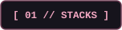
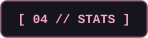

  

<!-- LINHA -->

  

<!-- ÍNDICE -->

  

<!-- BOTÕES -->

  &nbsp;
  &nbsp;
  &nbsp;
  

<!-- LINHA -->

  

## 🛠️ Languages & Tools

  

  

  
  

---

## 📈 GitHub Stats

  
  

---

## 📬 Contact

  

  
  
  <!-- Adicionar portifólio web -->
  <!--
  
  -->

