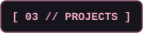
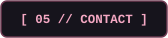
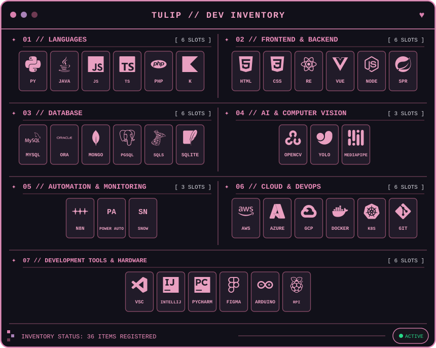
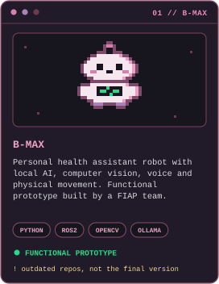
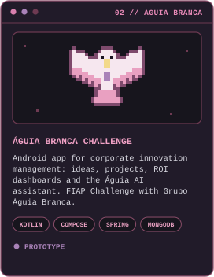
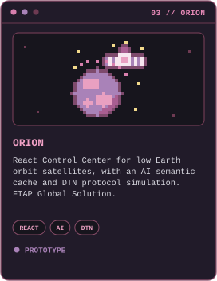

  

<!-- LINHA -->

  

<!-- ÍNDICE -->

  

<!-- BOTÕES -->

  &nbsp;
  &nbsp;
  &nbsp;
  

<!-- LINHA -->

  

<!-- STACKS -->

  

<!-- STACKS -->

  

<!-- LINHA -->

  

<!-- PROJECTS -->

  

  

<!-- PROJECT CARDS -->

  &nbsp;&nbsp;
  &nbsp;&nbsp;
  

<!-- PROJECT BUTTONS -->

   
  

<!-- LINHA -->

  

<!-- STATS -->

<!-- LINHA -->

  

<!-- Contact -->

<!-- LINHA -->

  

